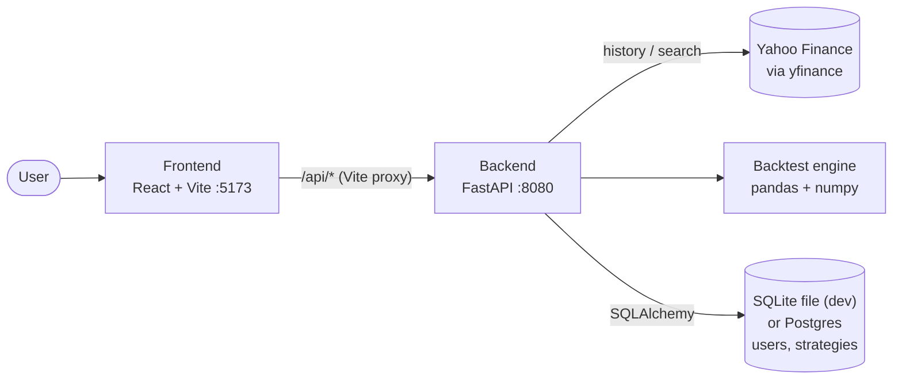
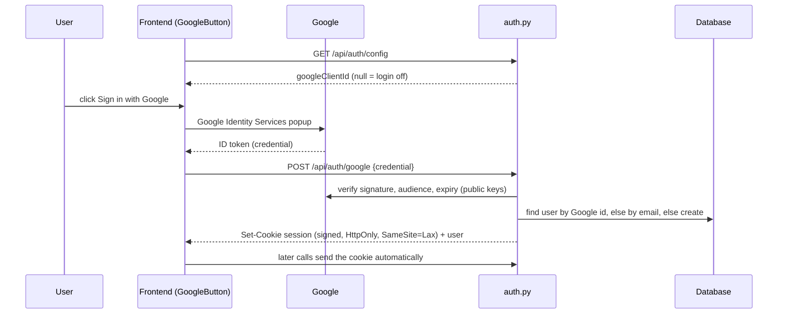
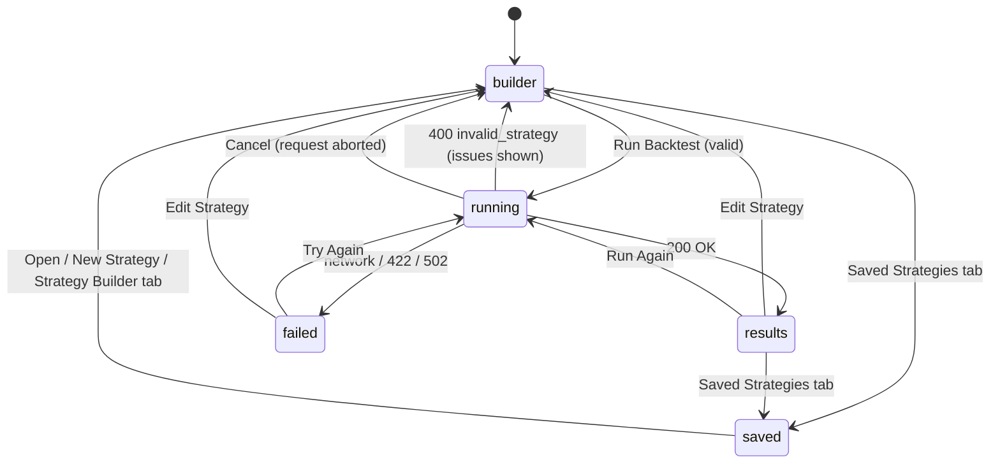
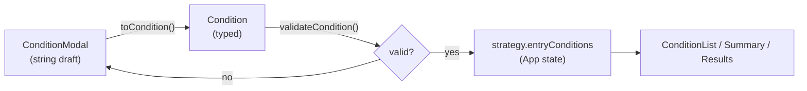
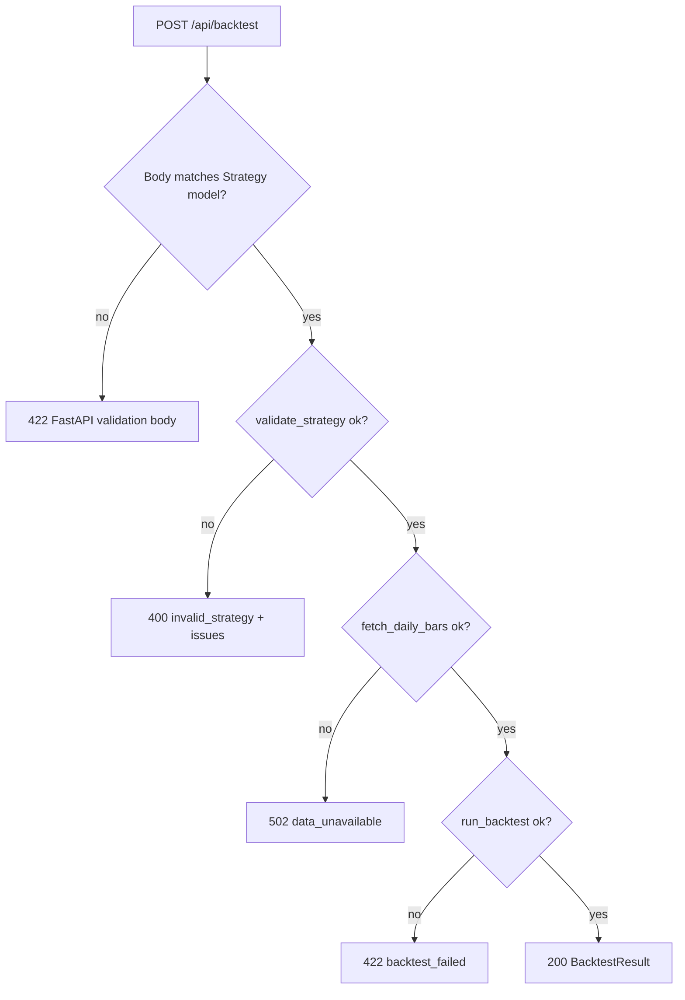
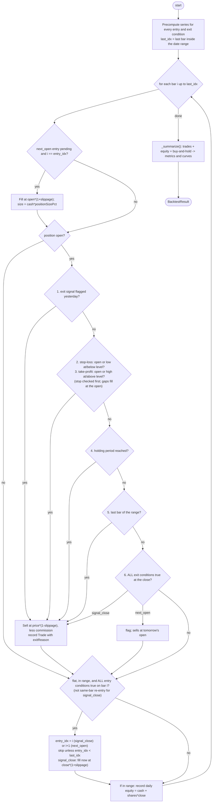

# Architecture and code flow

## 1. System overview



The browser only talks to the Vite dev server. `vite.config.ts` proxies every `/api` request to the FastAPI backend, so there are no CORS issues in development (the backend also allows all origins).

## 2. End-to-end flow: running a backtest

```mermaid
sequenceDiagram
    actor User
    participant SB as StrategyBuilder.tsx
    participant App as App.tsx
    participant API as api.ts
    participant R as api.py (FastAPI)
    participant D as data.py
    participant E as engine.py
    participant I as indicators.py
    participant Y as Yahoo Finance

    User->>SB: edit strategy, click "Run Backtest"
    SB->>SB: strategyIssues(): client-side validation
    alt issues found
        SB-->>User: show "N issues need your attention"
    else valid
        SB->>App: onRun()
        App->>App: view = running (Running.tsx), new AbortController
        App->>API: runBacktest(strategy, signal)
        API->>R: POST /api/backtest (JSON)
        R->>R: Pydantic parses body into Strategy (models.py)
        R->>E: validate_strategy()
        alt business-rule error
            R-->>API: 400 {error: invalid_strategy, issues[]}
            API-->>App: ApiError(kind=invalid)
            App-->>SB: back to builder with serverIssues
        else ok
            R->>D: fetch_daily_bars(asset, start, end)
            D->>Y: Ticker.history(start-400d .. end+1d)
            Y-->>D: OHLCV (adjusted)
            D-->>R: DataFrame (+ attrs.currency), cached 6h
            R->>E: run_backtest(strategy, df)
            E->>I: compute_series() for each operand
            I-->>E: indicator series
            E->>E: bar-by-bar simulation, metrics
            E-->>R: BacktestResult
            R-->>API: 200 result JSON
            API-->>App: BacktestResult
            App-->>User: Results.tsx (or "No trades" state)
        end
    end
    Note over R,D: Data failure -> 502 data_unavailable; engine error -> 422 backtest_failed.<br/>api.ts maps both to ApiError(kind=failed) -> Failed screen with Try Again / Edit Strategy.
```

### Saving and opening a strategy

```mermaid
sequenceDiagram
    actor User
    participant App as App.tsx
    participant API as api.ts
    participant S as strategies.py
    participant DB as Database

    User->>App: Save Strategy (builder or results)
    App->>App: SaveDialog: name + description
    App->>API: saveStrategy(id or null, ...)
    API->>S: POST /api/strategies (new) or PUT /api/strategies/{id} (opened one)
    S->>S: current_user(): session cookie -> user (401 if signed out; shared local user if login is off)
    S->>DB: INSERT/UPDATE strategies (definition stored as JSON)
    alt same name already used by this user
        S-->>API: 409 name_taken -> message shown in the dialog
    else ok
        S-->>App: saved strategy -> toast, App remembers its id
    end
    User->>App: Saved Strategies tab
    App->>API: listStrategies() -> GET /api/strategies
    API->>API: normalize(): period null -> absent
    User->>App: Open -> strategy loaded into the builder
```

Every query filters by `user_id`, so one user can never read, change or delete another's strategies (covered by a two-user test). With login on, `current_user()` reads the signed session cookie and returns 401 when there is none, so strategies are private to the signed-in Google account. With login off (no `GOOGLE_CLIENT_ID`), it returns one shared local user, so nothing is private.

### Google sign-in



The browser never holds a token it can read: the session cookie is HttpOnly. Expired or missing sessions come back as 401, which the frontend turns into the sign-in dialog.

## 3. Frontend

### Screen state machine (`App.tsx`)



`App.tsx` holds the single `Strategy` object, the id of the saved strategy being edited (if any), a top navigation bar, and a `view` union. There is no router. A new run aborts any in-flight request (`AbortController`).

### Components

| File | Responsibility |
|---|---|
| `StrategyBuilder.tsx` | Page layout; asset, dates, entry conditions, exit rules (holding period, stop-loss, take-profit, exit signal), execution settings, live summary; `strategyIssues()` mirrors the backend rules so users get errors before a request |
| `SymbolPicker.tsx` | Combobox. Debounces 250 ms, calls `GET /api/symbols/search`, aborts stale requests, keyboard support |
| `ConditionList.tsx` | Renders conditions with AND connectors, inline "Remove this condition?" confirm, empty state, scroll area |
| `ConditionModal.tsx` | Add/edit form. Holds string-valued draft state, converts to a typed `Condition`, validates via `validateCondition()` |
| `Running.tsx` | Spinner and Cancel |
| `Results.tsx` | Equity chart, performance (incl. buy-and-hold comparison) and trade cards, sortable/filterable table, warnings banner, "No trades" state; also exports `Failed` |
| `EquityChart.tsx` | SVG line chart: strategy vs buy & hold, legend, hover crosshair + tooltip, "View as table" toggle. Colors are categorical slots 1-2 of the dataviz palette, validated for the dark surface |
| `SavedStrategies.tsx` | Saved list (open, confirm-delete), loading / empty / error states |
| `SaveDialog.tsx` | Name + description; shows server errors such as a duplicate name |
| `TradeDrawer.tsx` | Right-side drawer: result, return, P&L, entry/exit, "Why did this trade trigger?" from `entryReasons` |
| `ui.tsx` | Shared primitives (Button, Section, Field, Stat, Modal) and `useEscape` (Escape closes modals and the trade drawer) |

### Supporting modules

- `types.ts` mirrors `backend/alphabacktest/models.py`. Keep both in sync by hand.
- `conditions.ts` is the catalog of indicators (which need a period) and operators, label helpers, and per-condition validation.
- `api.ts` wraps `fetch`. It turns HTTP errors into `ApiError` with `kind: "invalid"` (fixable, 400) or `"failed"`, never exposing raw backend errors.
- `format.ts` formats dates, percentages, and currency using the asset's currency code (`Intl`).

### Condition editing data flow



## 4. Backend

### Modules

| File | Role |
|---|---|
| `api.py` | HTTP only. Routes: `GET /api/health`, `GET /api/symbols/search`, `POST /api/backtest`; mounts the strategies router. Maps failures to status codes; creates tables at startup |
| `auth.py` | Google sign-in (`/api/auth/config`, `/google`, `/me`, `/logout`), signed session cookie, and `current_user()` used by every user-scoped route |
| `strategies.py` | Saved-strategy CRUD under `/api/strategies`, scoped to `current_user()` |
| `db.py`, `orm.py` | SQLAlchemy engine/session (`DATABASE_URL`, SQLite by default) and the `users` / `strategies` tables (strategy definition stored as JSON/JSONB) |
| `models.py` | Pydantic models: `Strategy`, `Condition`, `Indicator`/`Value` operands, `Trade`, `BacktestResult` |
| `data.py` | `fetch_daily_bars()` (400-day warm-up, adjusted prices, 6 h cache, currency in `df.attrs`) and `search_symbols()` (stocks and ETFs only, cached) |
| `indicators.py` | `sma`, `ema` (SMA-seeded), `rsi` (Wilder), `bollinger` (2 population std devs), `macd`; `compute_series()` maps an operand to a series |
| `engine.py` | `validate_strategy()`, condition evaluation, simulation loop, `_summarize()` metrics |

### Endpoint decision flow



### Engine simulation loop (`engine.run_backtest`)



### Condition evaluation

For bar `i`, with left series `l` and right series `r` (a right-hand fixed value is a constant series):

| Operator | True when |
|---|---|
| `greater_than` / `less_than` / `equals` | `l[i] > r[i]` / `<` / equal within 1e-9 |
| `crosses_above` | `l[i-1] <= r[i-1]` and `l[i] > r[i]` |
| `crosses_below` | `l[i-1] >= r[i-1]` and `l[i] < r[i]` |

Any NaN (indicator not warmed up yet) makes the condition false. All conditions must be true (AND).

### Metrics (`_summarize`)

- **Equity curve:** cash plus open position value at each in-range close (returned as `equityCurve`)
- **Buy and hold:** initial capital scaled by close / first in-range close, before costs (`benchmarkCurve`, `buyHoldReturnPct`, `buyHoldMaxDrawdownPct`)
- **Total return:** final equity / initial capital - 1
- **CAGR:** annualised over first-to-last equity date (365.25-day year)
- **Max drawdown:** minimum of equity / running peak - 1
- **Sharpe:** mean / std of daily equity returns * sqrt(252), risk-free rate 0
- **Win rate, avg trade/win/loss:** from trade return percentages
- **Profit factor:** gross profit / gross loss in currency P&L (`null` if no losses)

## 5. Data contract

The request/response JSON is defined once in `models.py`, mirrored in `frontend/src/types.ts`, and documented with examples in `backend/README.md`. When changing a field, update all three.

## 6. Testing

- `tests/test_engine.py`: indicators (SMA, EMA seeding, RSI edge case); AND logic, next-open and signal-close entry, costs, no trades, empty strategy rejected, end-of-range close, currency; exit rules (stop-loss intrabar and on a gap, take-profit, stop wins a same-day tie, signal exit in both timings, time exit alongside others, at least one exit rule required); buy-and-hold benchmark and curves.
- `tests/test_indicators_crosscheck.py`: our SMA, EMA, RSI, Bollinger and MACD against the `ta` library on a seeded random walk (equal after warm-up; needs `requirements-dev.txt`).
- `tests/test_strategies_api.py`: CRUD round trip, duplicate name, invalid definition, and per-user privacy with two users.
- The engine was checked against an independent script (RELIANCE.NS, RSI(10) crosses below 40, 10-day hold): with `signal_close` the trade dates, total return, CAGR, drawdown and Sharpe match.
- The frontend was click-tested in headless Chrome (symbol search, exit rules, condition modal, run, chart hover, table view, trade drawer, saved tab). There is no repeatable frontend test suite yet.

## 7. Extending

| To add | Touch |
|---|---|
| New indicator | `models.py` (`IndicatorName`), `indicators.py` (`compute_series`), `types.ts`, `conditions.ts` (`INDICATORS`, `SHORT`), tests |
| New exit rule | `models.py` (Strategy), `engine.py` (`validate_strategy` and the exit checks in the loop), `types.ts`, builder UI, README contract |
| New endpoint | `api.py` (plus `models.py` if it has a new body), `api.ts` wrapper |
| Different data source | `data.py` only: return a DataFrame with `date, open, high, low, close, volume` and `attrs["currency"]` |
